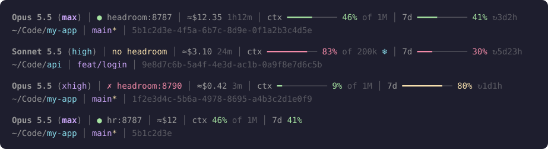

# claude-statusline

A compact status line for [Claude Code](https://code.claude.com): one bash script, no configuration.



## What it shows

| Segment | Meaning |
|---|---|
| `Opus 5.5 (max)` | Model and effort level. `⚡fast` when fast mode is on. |
| `headroom:8787` | The session's API calls go through a local proxy on that port. Green: [Headroom](https://docs.headroomlabs.ai) answers. Red `✗`: nothing answers, so the calls will fail. Dim `proxy:PORT`: a local proxy that is not Headroom. Yellow `no headroom`: Headroom is installed but this session bypasses it. Hidden if you use neither. |
| `my-app \| main*` | Project and git branch. `*` means uncommitted changes. |
| `≈$12.35 1h12m` | Estimated session cost at API list prices, and session time. |
| `ctx 46%` | Context window used: green below 60%, yellow up to 79%, red from 80%. |
| `❄` | The prompt cache has expired: your next message re-sends the whole context at full price. |
| `5h 24% ↻1h22m · 7d 41% ↻3d2h` | Subscription usage windows (Pro, Max) and the time left until they reset. |

The 5h and 7d colours look ahead: they show where you will be at the end of the window if you keep the current pace. Green below 85%, yellow up to 99%, red when you would run out before the reset. So 41% with six days still to go is red, while 41% with one day left is green.

On a narrow terminal the line shrinks step by step: first the reset countdowns go, then the cents (and `headroom` becomes `hr`), then the project name, then the session time.

## Install

You need Claude Code, bash 3.2 or later and [jq](https://jqlang.org). git and curl are optional. Works on macOS and Linux.

```sh
git clone https://github.com/domvsca/claude-statusline.git
cd claude-statusline
./install.sh
```

The installer links `statusline.sh` into `~/.claude/` and sets `statusLine` in `~/.claude/settings.json`. Everything else in that file stays as it is, and the old file is kept as a backup. To update later, run `git pull` in the folder.

- `./install.sh --copy` copies the script instead of linking it, so you can delete the folder.
- `CLAUDE_CONFIG_DIR` is honoured.
- `./uninstall.sh` removes it again.

To install by hand, copy `statusline.sh` to `~/.claude/` and add this to `~/.claude/settings.json`:

```json
"statusLine": { "type": "command", "command": "bash ~/.claude/statusline.sh" }
```

## Tips

- Countdowns and session time change when Claude Code refreshes the status line, which happens after each message. To keep them ticking while you are idle, add `"refreshInterval": 60` to the `statusLine` block.
- A refresh takes about 50 ms: one jq call, git status cached for 5 seconds per folder, the proxy checked at most every 15 seconds.

## Development

```sh
bash test/run.sh
```

The tests feed sample payloads to the script in a clean environment. CI runs them on macOS and Linux.

## License

[MIT](LICENSE)
